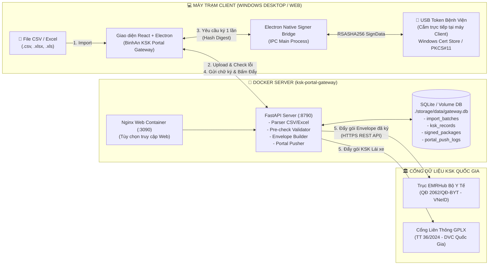
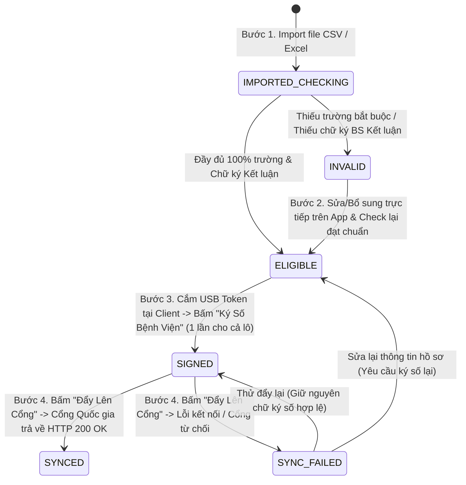

# KẾ HOẠCH TRIỂN KHAI & KIỂM TOÁN KỸ THUẬT (PLAN & AUDIT)
# HỆ THỐNG ĐẨY CỔNG DỮ LIỆU KHÁM SỨC KHỎE QUỐC GIA ĐỘC LẬP (`KSK PORTAL GATEWAY`)

* **Đơn vị chủ quản:** Bệnh viện Đa khoa Bình An (Mã CSKCB mặc định: `91034` — Hỗ trợ đa cơ sở khi triển khai nơi khác)
* **Thư mục dự án:** `D:\bv-binhan\projects\ksk-portal-gateway`
* **Kiến trúc triển khai:** Tách biệt hoàn toàn **Server Backend (FastAPI + Docker)** và **Client App (Electron Desktop + React Vite + USB Token Bridge)**
* **Nhiệm vụ duy nhất (Single Responsibility):** Nhập dữ liệu KSK từ **CSV / Excel** $\rightarrow$ **Kiểm tra đầy đủ các trường & chữ ký kết luận** $\rightarrow$ **Ký số điện tử Bệnh viện (USB Token cắm trực tiếp tại máy Client, ký 1 lần cho toàn bộ hồ sơ hợp lệ)** $\rightarrow$ **Đẩy dữ liệu lên Cổng Khám sức khỏe Quốc gia**.
* **Ngày lập kế hoạch & Audit:** 10/11/2026
* **Phiên bản:** `v1.0.0`

---

## MỤC LỤC
1. [TỔNG QUAN MỤC TIÊU & PHẠM VI TÁCH DỰ ÁN](#1-tổng-quan-mục-tiêu--phạm-vi-tách-dự-án)
2. [KIẾN TRÚC TỔNG THỂ: DOCKER SERVER & STANDALONE CLIENT](#2-kiến-trúc-tổng-thể-docker-server--standalone-client)
3. [QUY TRÌNH NGHIỆP VỤ 4 BƯỚC NGHIÊM NGẶT (STATE MACHINE)](#3-quy-trình-nghiệp-vụ-4-bước-nghiêm-ngặt-state-machine)
4. [ĐẶC TẢ BỘ PARSER IMPORT CSV / EXCEL & CHUẨN HÓA TRƯỜNG](#4-đặc-tả-bộ-parser-import-csv--excel--chuẩn-hóa-trường)
5. [MA TRẬN KIỂM TRA (PRE-CHECK AUDIT): TRƯỜNG DỮ LIỆU & CHỮ KÝ](#5-ma-trận-kiểm-tra-pre-check-audit-trường-dữ-liệu--chữ-ký)
6. [KIẾN TRÚC KÝ SỐ ĐIỆN TỬ BỆNH VIỆN TẠI MÁY CLIENT (USB TOKEN 1-CLICK BATCH SIGNING)](#6-kiến-trúc-ký-số-điện-tử-bệnh-viện-tại-máy-client-usb-token-1-click-batch-signing)
7. [THIẾT KẾ CƠ SỞ DỮ LIỆU & ĐẶC TẢ REST API](#7-thiết-kế-cơ-sở-dữ-liệu--đặc-tả-rest-api)
8. [KIỂM TOÁN AN TOÀN THÔNG TIN & ĐÓNG GÓI TRIỂN KHAI (AUDIT CHECKLIST)](#8-kiểm-toán-an-toàn-thông-tin--đóng-gói-triển-khai-audit-checklist)

---

## 1. TỔNG QUAN MỤC TIÊU & PHẠM VI TÁCH DỰ ÁN

### 1.1. Bối cảnh & Lý do tách hệ thống
Trong hệ thống cũ (`ksk-sync-system`), phân hệ đẩy cổng KSK Quốc gia đang gắn chặt với cơ sở dữ liệu nội bộ Viettel-HIS (`192.168.1.2`) và đi kèm nhiều phân hệ khác (Giám định BHYT 09/BH, Bảng kê TT12, QĐ130, KSK Đoàn...). Điều này gây khó khăn khi cần cài đặt độc lập tại một máy trạm chuyên trách hoặc triển khai nhanh cho một cơ sở y tế khác.

Do đó, dự án mới **`ksk-portal-gateway`** được tách riêng hoàn toàn với các nguyên tắc cốt lõi:
1. **Chỉ làm 1 nhiệm vụ duy nhất:** Nhận dữ liệu khám sức khỏe, kiểm tra tính hợp lệ, ký số điện tử bệnh viện và đẩy lên Cổng dữ liệu Khám sức khỏe Quốc gia (Bộ Y Tế EMRHub theo QĐ 2062/QĐ-BYT & Cổng GPLX theo TT 36/2024/TT-BYT).
2. **Đầu vào độc lập (File-driven):** Chỉ nhận dữ liệu qua file **CSV (`.csv`)** và **Excel (`.xlsx`, `.xls`)**. Không phụ thuộc cứng vào SQL Server của bất kỳ HIS nào.
3. **Sẵn sàng đóng gói Docker (`docker-compose.yml`):** Dễ dàng dựng Server ở bất kỳ máy chủ Windows/Linux nào chỉ với 1 lệnh `docker compose up -d --build`.
4. **Tách biệt rõ ràng bước "Ký số" và bước "Đẩy cổng":**
   - USB Token chữ ký số của Bệnh viện được **cắm trực tiếp vào máy Client**.
   - Kiểm tra (Check) trước toàn bộ hồ sơ: Hồ sơ nào thiếu thông tin phải báo rõ và chặn ký; cho phép ký số khi toàn bộ hồ sơ đã đầy đủ hoặc chọn ký số riêng cho những hồ sơ đã đầy đủ thông tin.
   - **Ký số 1 lần duy nhất** cho tất cả hồ sơ được chọn (không bắt nhập PIN hay ký lặp lại từng hồ sơ).
   - **Sau khi ký số xong**, người dùng bấm nút **"Đẩy lên Cổng"** thì hệ thống mới thực sự truyền gói tin đã ký lên Cổng Quốc gia.

---

## 2. KIẾN TRÚC TỔNG THỂ: DOCKER SERVER & STANDALONE CLIENT

---

## 3. QUY TRÌNH NGHIỆP VỤ 4 BƯỚC NGHIÊM NGẶT (STATE MACHINE)

Mỗi hồ sơ KSK sau khi được import từ CSV/Excel sẽ đi qua chu trình trạng thái chặt chẽ, tuyệt đối không thể nhảy cóc:

### Quy tắc kiểm soát chuyển trạng thái (Gate Rules):
1. **Quy tắc Chặn Ký Số (`INVALID` $\nrightarrow$ `SIGNED`):**
   - Trước khi ký số, hệ thống chạy lệnh **Kiểm tra (Check)** toàn bộ hồ sơ.
   - Nếu người dùng chọn chế độ **"Ký toàn bộ lô"** mà vẫn còn $\ge 1$ hồ sơ thiếu thông tin (`INVALID`), hệ thống lập tức cảnh báo danh sách hồ sơ thiếu và yêu cầu bổ sung đủ trước khi ký, **HOẶC** cho phép người dùng bấm **"Chỉ ký số các hồ sơ đã đầy đủ thông tin (`ELIGIBLE`)"**.
   - Bất kỳ hồ sơ nào đang ở trạng thái `INVALID` đều bị khóa cứng, không thể sinh chữ ký số bệnh viện.
2. **Quy tắc Ký Số 1 Lần (`ELIGIBLE` $\rightarrow$ `SIGNED`):**
   - Với $N$ hồ sơ hợp lệ được chọn (ví dụ 200 hồ sơ), Server tổng hợp dữ liệu chuẩn hóa, tạo chuỗi băm tổng (`master_digest = SHA256(Header).SHA256(Data_Base64)`) và danh sách băm từng hồ sơ.
   - Máy Client gọi USB Token **đúng 1 lần duy nhất** để ký lên khối dữ liệu, sau đó gắn chữ ký số điện tử của Bệnh viện (`hospital_signature`), số Serial chứng thư số (`cert_serial`), tên chủ thể (`cert_subject`) và thời gian ký (`signed_at`) cho toàn bộ $N$ hồ sơ đó.
3. **Quy tắc Chặn Đẩy Cổng Khi Chưa Ký (`ELIGIBLE` $\nrightarrow$ `SYNCED`):**
   - Hồ sơ dù đã đủ thông tin (`ELIGIBLE`) nhưng **chưa thực hiện Ký số Bệnh viện (`SIGNED`)** thì nút **"Đẩy lên Cổng"** vẫn bị vô hiệu hóa đối với hồ sơ đó.
   - Chỉ khi hồ sơ đã có trạng thái **`SIGNED` (Đã ký số BV)** và người dùng chủ động bấm **"Đẩy dữ liệu lên Cổng"**, Server mới thực hiện gọi API đẩy gói tin đã ký lên Cổng Quốc gia.

---

## 4. ĐẶC TẢ BỘ PARSER IMPORT CSV / EXCEL & CHUẨN HÓA TRƯỜNG

Hệ thống chỉ chấp nhận 2 định dạng tệp đầu vào:
- **Excel:** `.xlsx`, `.xls` (Đọc qua `openpyxl`)
- **CSV:** `.csv` (Tự động nhận diện bảng mã `UTF-8-SIG`, `UTF-8`, `CP1258`, `Latin-1` và dấu phân cách `,`, `;`, `\t`)

### Bảng ánh xạ cột thông minh (Smart Column Mapping):
Bộ Parser hỗ trợ nhận diện tự động cả tiêu đề tiếng Việt có dấu, không dấu, hoặc tên trường kỹ thuật SQL/JSON:

| Nhóm | Trường chuẩn hệ thống | Các tên cột CSV/Excel tự động nhận diện | Bắt buộc |
| :--- | :--- | :--- | :---: |
| **1. Hành chính** | `ma_kcb` | `ma_kcb`, `makcb`, `Mã KCB`, `Mã hồ sơ`, `Số phiếu` | **Có** |
| | `ma_benh_nhan` | `ma_benh_nhan`, `mabn`, `Mã BN`, `Mã bệnh nhân` | Khuyến nghị |
| | `ho_va_ten` | `ho_va_ten`, `hoten`, `Họ và tên`, `Họ tên`, `Tên bệnh nhân` | **Có** |
| | `so_cccd` | `so_cccd`, `socmnd`, `cccd`, `cmnd`, `Số CCCD`, `Số CMND/CCCD` | **Có (9/12 số)** |
| | `ngay_sinh` | `ngay_sinh`, `ngaysinh`, `Ngày sinh`, `Năm sinh`, `DOB` | **Có** |
| | `gioi_tinh` | `gioi_tinh`, `gioitinh`, `Giới tính`, `Phái` (`Nam`/`Nữ`/`1`/`2`) | **Có** |
| | `so_dien_thoai` | `so_dien_thoai`, `dienthoai`, `sdt`, `Số điện thoại` | Khuyến nghị |
| | `dia_chi` | `dia_chi`, `diachi`, `Địa chỉ`, `Nơi ở hiện tại` | **Có** |
| | `ngay_kham` | `ngay_kham`, `ngaydk`, `Ngày khám`, `Ngày đăng ký` | **Có** |
| | `loai_ksk` | `loai_ksk`, `loai_kham_suc_khoe`, `Loại KSK` (`DINH_KY` / `LAI_XE`) | **Có** |
| **2. Thể lực** | `chieu_cao` | `chieu_cao`, `chieucao`, `Chiều cao`, `Chiều cao (cm)` | **Có (ĐK)** |
| | `can_nang` | `can_nang`, `cannang`, `Cân nặng`, `Cân nặng (kg)` | **Có (ĐK)** |
| | `bmi` | `bmi`, `BMI`, `Chỉ số BMI` *(Tự động tính nếu trống)* | **Có (ĐK)** |
| | `mach` | `mach`, `Mạch`, `Mạch (lần/phút)` | **Có** |
| | `huyet_ap` | `huyet_ap`, `huyetap`, `Huyết áp`, `Huyết áp (mmHg)` | **Có (`120/80`)** |
| **3. Lâm sàng** | `kham_noi_khoa` | `kham_noi_khoa`, `noi_khoa`, `tuan_hoan`, `Khám Nội khoa`, `Tuần hoàn` | **Có** |
| | `kham_ngoai_khoa`| `kham_ngoai_khoa`, `ngoai_khoa`, `Khám Ngoại khoa` | **Có** |
| | `kham_san_phu_khoa`| `kham_san_phu_khoa`, `san_phu_khoa`, `Khám Sản phụ khoa` | **Có (với Nữ)** |
| | `kham_mat` | `kham_mat`, `mat`, `mat_benh`, `Khám Mắt` | **Có** |
| | `kham_tmh` | `kham_tmh`, `tai_mui_hong`, `tmh_benh`, `Khám TMH`, `Tai mũi họng` | **Có** |
| | `kham_rhm` | `kham_rhm`, `rang_ham_mat`, `rhm_benh`, `Khám RHM`, `Răng hàm mặt` | **Có** |
| | `kham_da_lieu` | `kham_da_lieu`, `da_lieu`, `Khám Da liễu` | **Có** |
| **4. Cận lâm sàng**| `x_quang_phoi` | `x_quang_phoi`, `cdha`, `Ket_Qua_XQuang`, `X-Quang phổi` | **Có (ĐK)** |
| | `cong_thuc_mau` | `cong_thuc_mau`, `huyet_hoc`, `Công thức máu`, `Xét nghiệm máu` | **Có (ĐK)** |
| | `sinh_hoa_mau` | `sinh_hoa_mau`, `duong_huyet`, `Sinh hóa máu`, `Đường huyết` | **Có (ĐK)** |
| | `xet_nghiem_nuoc_tieu`| `xet_nghiem_nuoc_tieu`, `nuoc_tieu`, `Xét nghiệm nước tiểu` | **Có** |
| | `test_ma_tuy` | `test_ma_tuy`, `matuy`, `Test_Ma_Tuy`, `Xét nghiệm Ma túy` | **Có (Lái xe)** |
| | `nong_do_con` | `nong_do_con`, `nongdocon`, `Nong_Do_Con`, `Nồng độ cồn` | **Có (Lái xe)** |
| | `hang_bang_lai` | `hang_bang_lai`, `hangxe`, `Hang_Bang_Lai`, `Hạng bằng lái` | **Có (Lái xe)** |
| **5. Kết luận & Chữ ký**| `phan_loai_sk` | `phan_loai_sk`, `phanloai`, `Phan_Loai_Suc_Khoe`, `Phân loại sức khỏe` | **Có** |
| | `ket_luan_benh` | `ket_luan_benh`, `kl_benh`, `Ket_Luan`, `Kết luận bệnh tật` | **Có** |
| | `bs_ket_luan` | `bs_ket_luan`, `bac_si_ket_luan`, `Ma_BS_Ket_Luan`, `Bác sĩ kết luận` | **Có** |
| | `cchn_bs_ket_luan`| `cchn_bs_ket_luan`, `so_cchn`, `CCHN Bác sĩ kết luận` | **Có** |
| | `chuky_ket_luan` | `chuky_ket_luan`, `da_ky_ket_luan`, `Chữ ký kết luận` (`Đã ký`/`1`/`True`/Chuỗi ký)| **Có** |
| | `chuky_chuyen_khoa`| `chuky_chuyen_khoa`, `da_ky_chuyen_khoa`, `Chữ ký chuyên khoa` | **Có** |
| | `ngay_ket_luan` | `ngay_ket_luan`, `kl_ngay`, `Ngay_Ket_Luan`, `Ngày kết luận` | **Có** |

---

## 5. MA TRẬN KIỂM TRA (PRE-CHECK AUDIT): TRƯỜNG DỮ LIỆU & CHỮ KÝ

Hệ thống thực hiện kiểm tra 4 lớp đối với từng dòng hồ sơ được import:

1. **Lớp 1 — Định danh Công dân (Đề án 06 - VNeID):**
   - `ho_va_ten`: Không được rỗng, tối thiểu 3 ký tự.
   - `so_cccd`: Bắt buộc 12 chữ số (CCCD gắn chip) hoặc 9 chữ số (CMND). Kiểm tra 3 số đầu thuộc danh mục 63 mã tỉnh/thành phố và đối soát 2 số năm sinh trên CCCD với `ngay_sinh`.
   - `ngay_sinh`, `gioi_tinh`, `dia_chi`, `ngay_kham`: Bắt buộc đầy đủ, đúng định dạng.
2. **Lớp 2 — Chỉ số Sinh hiệu & Chuyên khoa:**
   - Với KSK Định kỳ (`DINH_KY`): Bắt buộc có `chieu_cao` (100–230 cm), `can_nang` (25–200 kg), `bmi`, `mach` (40–200 l/p), `huyet_ap` đúng định dạng `TâmThu/TâmTrương` (Tâm thu > Tâm trương), và đầy đủ kết quả các chuyên khoa lâm sàng + cận lâm sàng.
   - Với KSK Lái xe (`LAI_XE`): Bắt buộc có `hang_bang_lai`, kết quả `test_ma_tuy` (Âm tính), `nong_do_con` và `huyet_ap`.
3. **Lớp 3 — Kết luận & Chữ ký Bác sĩ Kết luận (`chuky_ket_luan`, `bs_ket_luan`, `cchn_bs_ket_luan`):**
   - Bắt buộc có Phân loại sức khỏe (`LOAI_I`..`LOAI_V` hoặc `DU_DIEU_KIEN`).
   - Bắt buộc có Họ tên/Mã Bác sĩ Kết luận (`bs_ket_luan`) và Số CCHN (`cchn_bs_ket_luan`).
   - Bắt buộc có xác nhận Chữ ký kết luận (`chuky_ket_luan` đã ký) và đủ chữ ký các khoa lâm sàng (`chuky_chuyen_khoa`).
4. **Lớp 4 — Chữ ký số điện tử của Bệnh viện (`hospital_signature`):**
   - Chỉ được phép ký khi Lớp 1, Lớp 2, Lớp 3 đạt `0` lỗi (`is_eligible = True`).
   - Chỉ được phép đẩy lên Cổng Quốc gia khi Lớp 4 đã hoàn tất (`signing_status = 'SIGNED'`).

---

## 6. KIẾN TRÚC KÝ SỐ ĐIỆN TỬ BỆNH VIỆN TẠI MÁY CLIENT (USB TOKEN 1-CLICK BATCH SIGNING)

Vì Server chạy trong Docker (có thể đặt trên máy chủ LAN hoặc Cloud), trong khi **USB Token của Bệnh viện cắm trực tiếp vào cổng USB của máy Client**, kiến trúc ký số được thiết kế theo mô hình **Distributed Hash-Sign-Commit**:

1. **Bước 3.1 — Kiểm tra & Tạo Digest trên Server (`POST /api/records/prepare-signing`):**
   - Nhận danh sách ID hồ sơ cần ký (hoặc mã lô `batch_id`).
   - Kiểm tra điều kiện: Nếu bất kỳ hồ sơ nào trong danh sách yêu cầu còn thiếu thông tin (`is_eligible = False`), trả về danh sách lỗi chi tiết để người dùng sửa hoặc chọn chế độ **"Chỉ ký các hồ sơ đã đầy đủ thông tin"**.
   - Với danh sách hồ sơ đạt chuẩn 100%, Server đóng gói mảng JSON theo Phụ lục 02 Quyết định 2062/QĐ-BYT, mã hóa Base64 (`data_base64`), tạo `header` và tính:
     - $A = \text{Uppercase}(\text{SHA256}(\text{header\_compact}))$
     - $B = \text{Uppercase}(\text{SHA256}(\text{data\_base64}))$
     - $\text{string\_to\_sign} = A + "." + B$
     - Kèm theo mã băm riêng của từng hồ sơ `record_digests[id] = SHA256(record_canonical_json)`.
2. **Bước 3.2 — Ký số 1 lần tại Máy Client qua USB Token (`window.electronAPI.signBatchWithUsbToken`):**
   - Electron Main Process truy cập trực tiếp `Cert:\CurrentUser\My` trên máy Windows của người dùng để liệt kê danh sách Chứng thư số USB Token đang cắm (Viettel-CA, VNPT-CA, FPT-CA, BKAV-CA...) có `HasPrivateKey = True`.
   - Đồng thời cung cấp tùy chọn **Chứng thư số Nội bộ / Test CA RSA-2048** để kiểm thử ngay khi chưa cắm USB Token vật lý.
   - Tiến trình ký thực hiện **1 phiên duy nhất** bằng thuật toán `RSA-SHA256` (PKCS#1 v1.5) lên `string_to_sign` và lô hồ sơ, trả về chữ ký Base64 viết hoa chuẩn Bộ Y Tế.
3. **Bước 3.3 — Lưu trữ Chữ ký số Bệnh viện (`POST /api/records/commit-signature`):**
   - Server xác thực chữ ký, lưu `hospital_signature`, `cert_subject`, `cert_serial`, `cert_thumbprint`, `signed_at` vào từng hồ sơ và gói tin `signed_packages`, chuyển trạng thái hồ sơ sang **`SIGNED` (Đã ký số BV - Sẵn sàng đẩy cổng)**.

---

## 7. THIẾT KẾ CƠ SỞ DỮ LIỆU & ĐẶC TẢ REST API

### 7.1. Các bảng dữ liệu (`storage/data/gateway.db`)
1. `users`: Quản lý tài khoản đăng nhập ứng dụng.
2. `system_configs`: Cấu hình thông tin Bệnh viện (`ma_cskcb`, `ten_benh_vien`, `mst`), cấu hình Cổng Quốc gia (`env`, `sandbox_url`, `prod_url`, `portal_username`, `portal_password`, `simulation_mode`).
3. `import_batches`: Quản lý từng lần import file CSV/Excel (`id`, `batch_code`, `filename`, `file_type`, `total_rows`, `eligible_count`, `signed_count`, `synced_count`, `created_by`, `created_at`).
4. `ksk_records`: Lưu trữ chi tiết từng hồ sơ KSK, kết quả kiểm tra (`is_eligible`, `error_count`, `warning_count`, `validation_json`), trạng thái chữ ký kết luận, trạng thái ký số bệnh viện (`signing_status`, `hospital_signature`, `cert_serial`, `cert_subject`, `signed_at`), và trạng thái đẩy cổng (`sync_status`, `portal_msg_id`, `synced_at`, `sync_error`).
5. `signed_packages`: Lưu gói Envelope đã ký số điện tử bệnh viện (`package_id`, `batch_id`, `header_json`, `data_base64`, `checksum`, `string_to_sign`, `hospital_signature`, `cert_info_json`, `status`).
6. `portal_push_logs` & `audit_logs`: Lưu trọn vẹn lịch sử đẩy Cổng (Request/Response HTTP, thời gian xử lý ms) và nhật ký thao tác của người dùng.

### 7.2. Danh sách REST API chính
- `POST /api/auth/login`, `GET /api/auth/me`: Đăng nhập & xác thực JWT.
- `GET /api/templates/download/{fmt}`: Tải file mẫu chuẩn `.xlsx` hoặc `.csv` (KSK Định kỳ TT32 & KSK Lái xe TT36).
- `POST /api/batches/import`: Upload và bóc tách file `.csv` / `.xlsx`, tự động chạy kiểm tra (Pre-check) toàn bộ hồ sơ.
- `GET /api/records`, `GET /api/records/stats`, `GET /api/records/{id}`: Tra cứu, lọc hồ sơ theo trạng thái (`ALL`, `INVALID`, `ELIGIBLE`, `SIGNED`, `SYNCED`), xem chi tiết lỗi.
- `PUT /api/records/{id}`: Sửa/Bổ sung trực tiếp các trường còn thiếu của hồ sơ và tự động kiểm tra lại.
- `POST /api/records/bulk-complete`: Bổ sung nhanh các trường mặc định hợp lệ hoặc xác nhận chữ ký kết luận cho các hồ sơ được chọn, giúp hoàn thiện nhanh hồ sơ trước khi ký.
- `POST /api/records/check-before-sign`: Bước kiểm tra bắt buộc trước khi ký số — trả về thống kê hồ sơ đạt chuẩn và hồ sơ còn thiếu thông tin.
- `POST /api/records/prepare-signing`: Tạo gói Digest (`string_to_sign`) cho tất cả hồ sơ đủ điều kiện để máy Client ký số 1 lần.
- `POST /api/records/commit-signature`: Ghi nhận chữ ký số điện tử của Bệnh viện từ USB Token máy Client.
- `POST /api/records/push-portal`: Đẩy các hồ sơ **đã ký số (`SIGNED`)** lên Cổng dữ liệu Khám sức khỏe Quốc gia.

---

## 8. KIỂM TOÁN AN TOÀN THÔNG TIN & ĐÓNG GÓI TRIỂN KHAI (AUDIT CHECKLIST)

| Hạng mục Audit | Yêu cầu kỹ thuật | Trạng thái thiết kế |
| :--- | :--- | :---: |
| **1. Cô lập dự án** | Tách hoàn toàn sang `D:\bv-binhan\projects\ksk-portal-gateway`, không ảnh hưởng `ksk-sync-system`. | ✅ Đạt |
| **2. Hỗ trợ Docker** | Có `docker-compose.yml`, `server/Dockerfile`, `client/Dockerfile`, volume lưu trữ bền vững. | ✅ Đạt |
| **3. Định dạng Import** | Chỉ chấp nhận `.csv`, `.xlsx`, `.xls`; từ chối các định dạng lạ; hỗ trợ tải file mẫu ngay trên giao diện. | ✅ Đạt |
| **4. Kiểm tra trước khi ký** | Bắt buộc kiểm tra đầy đủ trường hành chính, thể lực, chuyên khoa và chữ ký kết luận trước khi mở khóa ký số. | ✅ Đạt |
| **5. Ký số USB Token tại Client**| Hỗ trợ đọc chứng thư số cắm trực tiếp tại máy Client (`Cert:\CurrentUser\My`), ký 1 lần cho toàn bộ hồ sơ đủ điều kiện. | ✅ Đạt |
| **6. Tách rời Ký số & Đẩy cổng**| Ký số xong hồ sơ chuyển sang `SIGNED`; chỉ khi bấm **Đẩy lên Cổng** mới thực sự gọi API đẩy dữ liệu. | ✅ Đạt |
| **7. Đóng gói Client `.exe`** | Kiểm tra `node --check`, đóng gói bộ cài NSIS `.exe` trong `client/dist-release/` dễ dàng cài đặt cho máy trạm. | ✅ Đạt |
